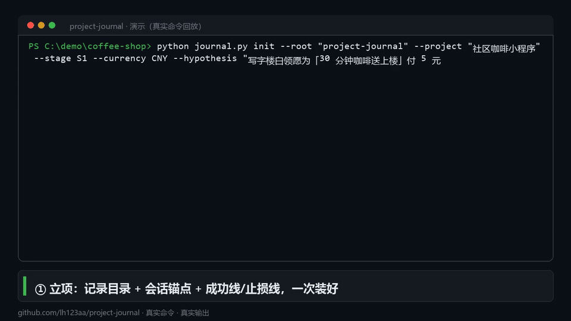

# project-journal · 项目飞行记录仪

> **给项目装一个飞行记录仪**：调用一次，此后每次 AI 会话自动记录决策、踩坑、解法、真实数字（时间/成本/转化/收入）——直到项目成功或失败。结项那天，直接产出一个**脱敏、可售的案例资产包**。
>
> ### 项目可以失败，但不能白失败。

<!-- 🎬 演示 GIF：按《06-演示视频脚本.md》录制，导出 demo.gif 放到 assets/ 后取消下面一行的注释 -->
<!--  -->

**30 秒理解它**

- 🚀 **不靠自觉**：在项目根注入会话锚点——未来任何一次会话（换工具、换 Agent、三天后）开工自动续记，你不需要每天记得"要记录"
- ✍️ **不写流水账**：只记有判断、有结论、有数字的东西——决策、卡点、解法、认知更新、真实数字
- 💰 **能收口**：立项时写死成功线与止损线；结项时按它们客观判定成败，并产出案例研究 / 打法手册 / 教训清单

[免费安装](#安装30-秒) ｜ [完整方法论包 ↓](#想要完整方法论) ｜ [English](README.en.md)

---

## 六个口令

**词组即命令**，不需要记完整句子：

| 你说 | 它做什么 |
|---|---|
| **跟踪项目** | 建立跟踪（首次）/ 继续跟踪（已有） |
| **记一下** | 把刚才的增量落盘（决策 / 问题 / 解法 / 认知 / 数字） |
| **项目状态** | 一行体检：阶段 / 停滞 / 未闭环 / 数字 |
| **复盘** | 生成周或月复盘骨架 |
| **结项** | 终局判定：成功 / 失败 / 转向 / 暂停 |
| **出资产** | 生成脱敏可销售资产包 |

也支持自然语言："帮我跟踪这个项目"、"记一下今天的"、"这个项目怎么样了"、"做完了总结下"、"能卖了吗"。
英文可用 `track this project` / `journal this`。

## 安装（30 秒）

```bash
git clone https://github.com/lh123aa/project-journal.git ~/.agents/skills/project-journal
# Windows: %USERPROFILE%\.agents\skills\project-journal
python ~/.agents/skills/project-journal/scripts/install-global.py   # 一键注册到各工具
```

覆盖：Claude Code / opencode / Cursor / Codex CLI / Gemini CLI / Windsurf。
依赖：**Python 3.8+，仅标准库**，零第三方依赖。

> 首次执行「跟踪项目」时，它会要求你写下**成功线与止损线**——这是最后判定"变现成功还是失败"的唯一客观标尺，别跳过。

## 它解决什么问题

项目过程中真正值钱的东西——**当时为什么这么选、卡在哪里、怎么绕过去的、真实数字是多少**——如果不落盘，三天后只剩模糊印象，三个月后连自己都答不上来。而这些正是项目结束后最值钱的资产：

- **给三个月后的自己**：不重复踩坑，复用有效动作
- **给下一个 AI / 协作者**：30 秒恢复上下文，不依赖聊天记录
- **给付费读者**：真实过程 + 真实数字 + 真实教训 = 可售案例

## 核心机制（"调用一次"就够的原理）

| 装置 | 作用 |
|---|---|
| ① 会话锚点 | 向项目根 `AGENTS.md` 注入托管块（幂等），未来任何会话开工自动续记 |
| ② 磁盘状态 | `STATE.md` + `tracker.json` 让人和 AI 30 秒恢复上下文，不依赖聊天历史 |
| ③ 收尾捕获 | "未记录 = 对后人而言没发生过"，每次会话结束前落盘 |
| ④ 可选心跳 | 宿主定时任务每日提醒补记 |

三层数据 + 一产出：

```
原始层  journal/YYYY-MM-DD.md      append-only，永不改写
档案层  records/（决策/问题/解法/实验/认知/教训/风险/里程碑）
数据层  metrics.csv · ledger.csv（指标与收支）
产出    publish/<日期>/  脱敏后可售的 8 个资产文件
```

## 它记录并修订自己（自我迭代）

这个技能把自己也当项目在管：

- 运行中发现的问题进 [`evolution/LEDGER.md`](evolution/LEDGER.md)——**21 条真实修复记录，每条带复现与回归用例**
- 每次修复先过 `scripts/selftest.py`——**38 项回归门禁**，不通过就中止发布
- 修复后自动升版本、写 CHANGELOG、迁移已有项目（**不动任何日记与档案**）

> 也就是说：**这本身就是一个"飞行记录仪记录自己诞生"的完整案例**。翻开台账即可围观。

## 想要完整方法论？

README 覆盖约 20%。「**项目飞行记录仪 · 方法论包**」包含：

- 📖 **方法论手册**：为什么记 / 记什么 / 怎么判（成功线止损线）/ 怎么把过程卖成资产
- 🧰 **12 个即用模板**：立项宪章、周复盘、结项判定、案例研究框架、脱敏清单…
- 📚 **真实案例库**：首发 1 篇真实案例（数字可查证），每季度增补
- 🎬 **30 分钟视频教程**（录制中，随 v0.2 免费交付）
- 🔄 **一年更新**

**¥99 早鸟（前 100 份，常规价 ¥199）** · 7 天无理由退款
👉 [小报童](#) ｜ [爱发电](#) ｜ 国际版 $19：[Gumroad](#)

> 需要 **1v1 陪跑**（把记录仪装进你的真实项目，4 周 + 结项资产包，¥2999）？[联系我](#)

## 快速开始

在项目根目录下：

```bash
S=~/.agents/skills/project-journal/scripts/journal.py

# 1) 立项（约定：记录目录 = 项目根的子文件夹 project-journal/）
python $S init --project "我的项目" --stage S0 --currency USD \
  --hypothesis "谁 + 什么痛点 + 愿意付多少 + 凭什么判断" \
  --success   "连续 3 个月净收入 >= 500 USD 且每日投入 < 1 小时" \
  --stop-loss "累计 200 小时且收入 < 100 USD"

# 2) 每次开工先读
python $S resume --root project-journal

# 3) 干活中随时落盘（正文用 --body-file，避免命令行转义）
python $S add --root project-journal --type decision --title "放弃 WhatsApp 渠道" --body-file d.md
python $S metric --root project-journal --name MRR --value 120 --unit USD --source Stripe
python $S ledger --root project-journal --kind income --amount 99 --channel Gumroad
python $S stage  --root project-journal --set S5 --why "拿到首单"

# 4) 收尾
python $S index --root project-journal && python $S lint --root project-journal

# 5) 定期复盘 / 项目终止 / 资产化
python $S review   --root project-journal --period weekly
python $S closeout --root project-journal --outcome success
python $S publish  --root project-journal        # 脱敏 -> 8 个可销售资产文件
```

## 命令一览

| 命令 | 用途 |
|---|---|
| `init` | 建立记录目录（幂等）+ 注入会话锚点 |
| `anchor` | 重新注入/刷新锚点 |
| `status` / `resume` | 一行体检 / 生成"补液包"（新会话开工先跑） |
| `add` / `update` | 追加记录 / 更新档案状态（如问题已解决） |
| `metric` / `ledger` | 指标 / 收入成本 |
| `stage` | 推进阶段 S0→S6 |
| `index` / `lint` | 重建索引 / 体检（结构、ID、密钥泄露、停滞、自我迭代信号） |
| `review` / `closeout` | 周月复盘骨架 / 终局档案与成败判定 |
| `publish` / `vault-index` | 脱敏资产包 / 跨项目总览 |
| `upgrade` / `doctor` | 迁移已有项目到当前版本 / skill 安装自检 |
| `evolve` / `evolve-list` / `evolve-apply` | 记录 skill 自身问题 / 查看台账 / 走完修复闭环 |

记录类型：`task` `decision` `problem` `solution` `insight` `experiment` `metric` `risk` `lesson` `revenue` `cost` `milestone` `question`

## 目录结构

```
SKILL.md                      入口：运行逻辑、触发器、铁律、自我迭代
manifest.json                 版本与元信息（版本号唯一来源）
CHANGELOG.md                  语义化版本变更日志
references/                   00 契约 / 01 分类法 / 02 写作指南 / 03 节奏 /
                              04 变现追踪 / 05 终止复盘 / 06 资产化 / 07 排障 / 08 自我迭代
scripts/journal.py            引擎（stdlib only，约 90KB）
scripts/selftest.py           回归自测（发布门禁）
templates/                    CHARTER / NEXT-ACTIONS / 各类记录蓝图 / 日记条目
evolution/                    自我迭代台账（ledger.json + LEDGER.md）
```

## 设计原则

- **脚本管结构，Agent 管判断**：脚本只做确定性机械工作（建目录、编号、索引、配对、脱敏、体检），内容由人/Agent 写
- **append-only**：日记与档案不改写；更正走新增条目并标注 `[更正 <ID>]`，历史是用来学习的
- **区分事实与判断**：主观判断必须显式标注，数字必须带单位/时间/来源/置信度
- **不编造**：没确认就写"待确认"，宁可留空
- **防泄露**：`lint` 扫描密钥与隐私，`publish` 强制脱敏并输出审计报告
- **成败以预先写死的线为准**：只有 CHARTER 里的成功线/止损线能判定项目成败

## 自测

```bash
python scripts/selftest.py      # 38/38
python scripts/journal.py doctor
```

> `scripts/selftest.py` 里包含用于验证脱敏的**假密钥与假邮箱**（如 `sk-abcdefghijklmnopqrstuvwx`），是测试夹具，不是真实凭据。

## 版本

**最新版本以 [manifest.json](manifest.json) 为准，变更历史见 [CHANGELOG.md](CHANGELOG.md)，修复台账见 [evolution/LEDGER.md](evolution/LEDGER.md)。**

> 本 README 刻意不写死版本号与统计数字 —— 手写的数字一定会过期，单一来源不会。

## 授权

### 双轨

| 轨 | 协议 | 费用 | 适用 |
|---|---|---|---|
| 免费轨 | [CC BY-NC 4.0](LICENSE) | ¥0 | 个人学习、研究、教学、非营利内部使用 |
| 商业轨 | [LICENSE-COMMERCIAL.md](LICENSE-COMMERCIAL.md) | ¥99 / ¥299 / ¥3k–10k | 公司商用、SaaS 集成、白标、内训、对外付费服务 |

**CC BY-NC 4.0 标识**

```
SPDX-License-Identifier: CC-BY-NC-4.0
```

**CC BY-NC 4.0（SPDX：CC-BY-NC-4.0）摘要**

| | |
|---|---|
| ✅ 允许 | 个人学习与使用；研究与教学；非营利组织内部使用；修改并分享（需署名、需保持相同授权、需注明改动） |
| ❌ 禁止 | 任何**商业用途**：公司内部业务使用、对外提供付费服务、打包进商业产品、用于获客变现的商业内容、转售 |
| ⚠️ 需授权 | 商业使用、企业内训、SaaS/产品集成、白标分发 —— 走 [LICENSE-COMMERCIAL.md](LICENSE-COMMERCIAL.md) |

> ℹ️ **为什么 GitHub 侧边栏显示 "Other"**：GitHub 的授权模板库不含 CC BY-NC 系列
> （`GET /licenses/cc-by-nc-4.0` 返回 404），所以**任何文本**都不会被识别成该许可 —— 这是平台限制，不是授权没设置。
> 授权以 [LICENSE](LICENSE) + [LICENSE-COMMERCIAL.md](LICENSE-COMMERCIAL.md) 为准；第三方授权扫描器（ScanCode / FOSSA / SBOM 工具）可按上面的 SPDX 标识识别。

**商用授权申请**：填写 [LICENSE-COMMERCIAL.md](LICENSE-COMMERCIAL.md) 末尾的签署块，通过 GitHub 主页 / 邮箱联系作者；电子签署有效。

### 历史版本说明

- **≤ v1.2.2**：MIT，**不可撤回**——已获取者可继续按 MIT 商用，无需签 LICENSE-COMMERCIAL
- **≥ v1.3.0**：CC BY-NC 4.0（非营利免费 + 商用双轨）
- **v1.4.0 起**：双轨授权正式生效，`manifest.json` 同步 `license_files` 字段

---

*本授权说明为便于理解的摘要，不构成法律意见；一切以 [LICENSE](LICENSE) 全文为准。*

📖 完整操作手册见 [USAGE.md](USAGE.md)。
